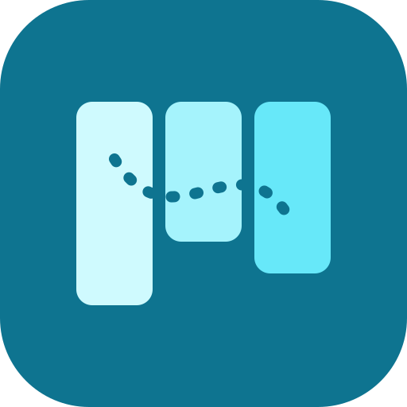
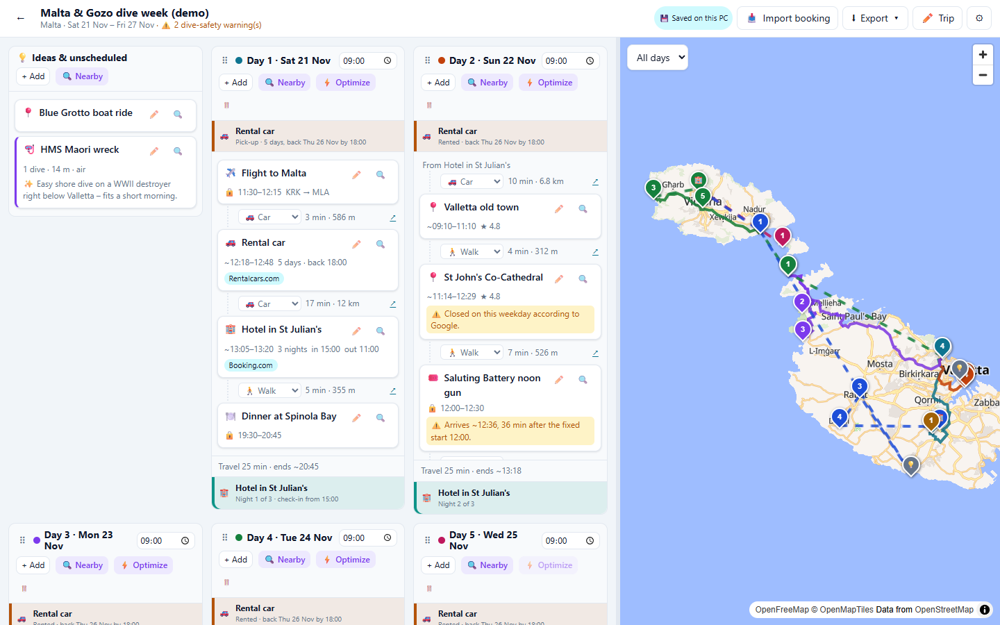
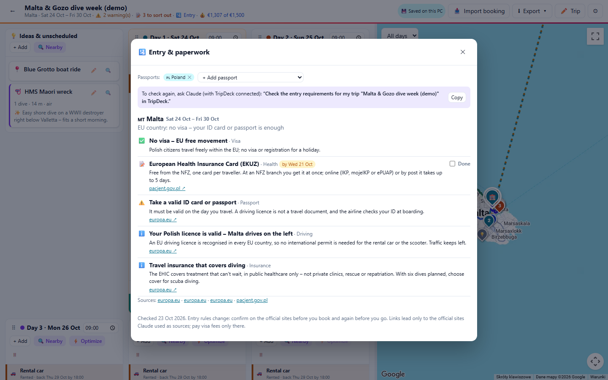
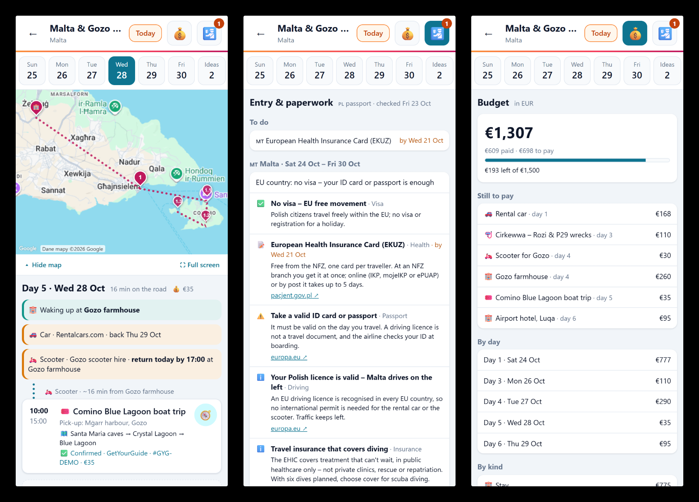
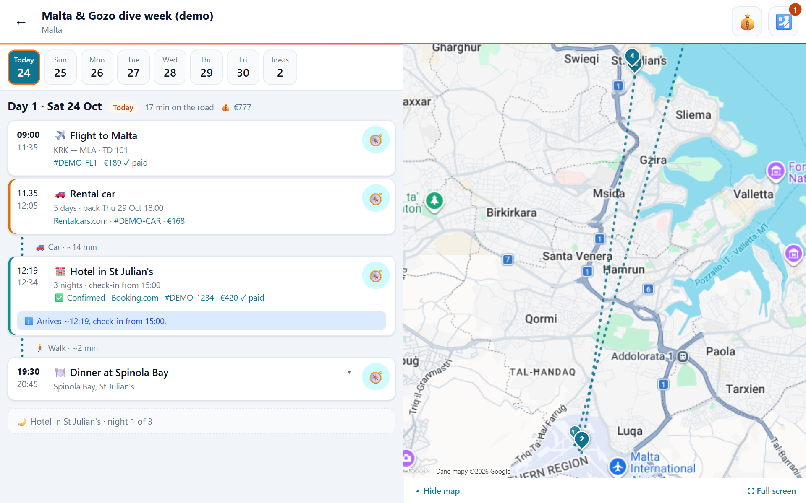

<h1> TripDeck</h1>

**A trip planner for people who want to see the whole trip at once – and plan it together with Claude or ChatGPT.** Each day is a column and each place is a card. Drag cards between days or move whole days. TripDeck works out how you get from one stop to the next – including public transport lines and clock changes on flights – adds up what the trip costs, keeps a list of what is still to book or apply for (visas and arrival forms included), and flags dive-safety problems such as flying too soon after diving. An MCP server lets Claude (Claude Code / Desktop) or ChatGPT (Codex) work on the same plan using **your own subscription, no API key needed**, and an Android app takes the plan on the road, offline.



## Features

- **Your trips, soonest first.** The home page lists every trip as a deck of cards: the trip under way or the next to start comes first, ended trips go last. Each shows how many days are left (or which day of the trip it is), the one under way or next in the logo's orange. *New trip* takes the first and last day or the number of days – fill in one and the other follows.
- **Drag-and-drop planning.** Move cards between days and the *Ideas* column, reorder them, or drag whole days. Works with mouse, touch and keyboard. Days wrap into rows that fit the window, and you can drag the divider between the board and the map to resize them (double-click resets it).
- **Flexible trip dates.** Change the first or last day in *Trip settings* at any time. Moving the first day shifts the whole trip; a later last day adds empty days, an earlier one removes days from the end and moves their cards to *Ideas*.
- **Routes between stops.** Each leg is calculated, starting from the hotel you woke up in. You choose the mode per leg: car, walk, bike, public transport or scooter. Ferry, boat and flight legs take a manual duration. Every leg has a one-tap link to Google Maps directions.
- **Flights, ferries and trains that know where they land.** Give a transport card an *Arrives at* place: the card's own place is the departure, its length is the journey in local clock times, and the next leg starts from the arrival – a taxi from the airport, not a drive from the city you flew out of. The map shows the arrival pin joined to the departure.
- **Time zones on the way.** Enter departure and arrival in local time, as printed on the ticket. TripDeck looks up both time zones (Google) and says when the clocks change and how long the journey really is – “🕐 Clocks go forward 4 h on arrival – the flight itself takes 6h 15m” – including easy-to-miss ones such as the hour between Mexico City and Cancún. Landing five hours or more from home adds a jet-lag note; an arrival time that can't add up is flagged.
- **Public transport with its lines.** With Google Maps, a public-transport leg is planned for the date and time in your plan (the day's first appointment is planned backwards: be there by its start). The leg shows the lines as coloured chips – for example 🚆 ARL → 🚇 Sukhumvit Line → 🚇 Silom Line from Bangkok's airport – and opens to every ride with its departure time, stops and direction. The map draws the rides in their line colours. When nothing runs at that hour (the last train has gone before a night flight) the leg says so. Timetables are only published a few weeks or months ahead; for a later trip TripDeck uses the same weekday and time in the coming week and says it's a typical week.
- **Today and the picked card.** During the trip, today's column has a warm header and a *Today* badge. Clicking a card (or its pin) lights it up on a soft orange and enlarges its pin on the map.
- **Day timeline.** Shows estimated arrival times, warns when you would be late for a fixed-time booking, and flags places that are closed that day. A stay's time is when you can check in, not an appointment: arriving later is fine, arriving before check-in gives a hint.
- **Stays and nights.** A stay has nights, a check-in time and a check-out time. The bottom of every day shows where you sleep that night (“Night 2 of 3”, check-in, check-out tomorrow), in the same colour on every night of that stay. Overnight flights and boats are recognised, and a night with no accommodation is flagged with a quick **+ Add stay**.
- **Rentals: car, scooter, motorbike or bicycle.** A rental card sits on the pick-up day and holds the vehicle, the rental company, the order number and price, the pick-up place and time, the number of days, and the return time and place (when it goes back somewhere else). Like a stay, it then shows at the top of every day you have it, and the return day says, for example, “Return today by 17:00 at Gozo farmhouse”. Booking import recognises rental confirmations. When the trip's default way of getting around is a vehicle you rent (a scooter, say), legs use it only from the pick-up card until it goes back – before and after, they default to a car (taxi), so you don't ride a scooter from the airport you just landed at.
- **Organised tours.** For a tour that picks you up (a boat trip, a day tour to Chichén Itzá), the card's place is the pick-up or meeting point – travel times go there – and *Places visited on the tour* lists where it goes. The map shows them as small pins joined by a dotted line from the pick-up, without counting them as legs; the card, the printable itinerary and the phone show “Pick-up: …” and the places in order. Claude fills in both when it adds a tour from a confirmation (MCP `tour_stops`).
- **Booking status and a to-do list.** Mark a booking ✅ *Confirmed*, ⏳ *Waiting for confirmation* or 📝 *To book*. The trip header shows “📝 3 to sort out”: visas and arrival forms to apply for (earliest deadline first), the bookings still to make or confirm and the nights with nowhere to sleep, each one click from its card, a new stay or the entry rules. The status also shows on the card, in the printable itinerary and on the phone.
- **Entry & paperwork.** Ask Claude to “check the entry requirements for my trip” and it researches, on the web, what it takes to enter every country on the route with your passports – transit countries included: visa or visa-free stay, passport validity, arrival cards (such as Thailand's TDAC) and when to fill them in, a driving permit when you rent a car or scooter, customs rules that catch travellers out. It saves them on the trip: *🛂 Entry rules* in the header lists each country with ✅ nothing to do, 📝 to do by a date, ⚠️ warnings and ℹ️ good to know, the official sources and links (only to the sites it used as sources, so no look-alike visa agency), and a tick for each formality once it's done. Set the passports in the same dialog (one or more). When the passports, the dates or the countries in the plan change, it says the check is out of date. Entry rules change: confirm on the official sites before you go.

  

- **Budget.** Write a card's price as it appears on the confirmation – “€189”, “1 500 THB”, “300 zł” – and tick *Paid* once it is paid. The trip header shows what the trip costs in one currency, and *💰 Budget* breaks it down by day and by kind of card (stays, transport, food…), with what is paid and what is still to pay, against an optional spending limit. Prices in other currencies are converted at the European Central Bank's daily rates (from frankfurter.dev, no key needed); the last rates fetched are kept for offline use. A stay or rental counts on the day it starts, and cards in *Ideas* are listed but not counted. The printable itinerary, the phone app (the 💰 button and each day's spend) and `get_trip` (MCP) show the totals too.
- **Dive planning.** Dive cards hold site, centre, number of dives, depth, gas and the mix once you know it (EAN32, Tx 18/45). TripDeck warns about flights less than 12 h after a single dive or 18 h after repetitive diving (DAN guidance), about going above 300 m altitude in that window, and suggests a rest day after long dive streaks. With [DiveDeck](https://github.com/Torgh/divedeck) connected to the same Claude Code or Codex, its coach prepares you for each dive card from your own dive log and the card shows ✅ *Prepared* or ⚠️ *Check prep*, with a one-line summary and a link to the full preparation.
- **Plan with Claude or ChatGPT (MCP).** Ask in plain language, for example “plan day 3 around Gozo”, “what's worth seeing near my hotel?” or “find my Booking.com and GetYourGuide confirmations in Gmail and add them”. The cards appear on the board within seconds. Changes made on the board at the same time are merged with Claude's, not lost.
- **No keys needed for maps.** OpenStreetMap powers the map (OpenFreeMap tiles), search (Photon), nearby places (Overpass, with a Wikipedia fallback), routing (OSRM) and elevation (Open-Meteo). If you add Google Maps keys, TripDeck uses Google's richer data and falls back to OSM if a Google API fails. Public-transport lines and time zones need Google; without it, public transport is estimated and journeys show no clock changes.
- **Your choice of storage: this PC, OneDrive or Google Drive.** Trips start in `~/.tripdeck/trips`. Choose OneDrive and they go into a visible **TripDeck** folder in OneDrive, synced by the OneDrive app, with no sign-in needed. Choose Google and they go into *My Drive › TripDeck*; TripDeck can't see your other Drive files. Each trip is one `Name (id).tripdeck.json` file, the same format as *Export → JSON*. Switch in *Settings* at any time; your trips are copied to the new place.
- **Optional in-app AI.** With an Anthropic API key, the ✨ buttons give AI suggestions, an AI day optimizer, visiting tips and booking import (paste an email or upload a PDF or screenshot) directly in the app.
- **Export as PDF or JSON.** *Export → PDF* opens a printable itinerary to save as a PDF: a map zoomed on the trip's area (flights more than 1000 km from all your stops, such as the flights from home, are left out), an overview of days and nights, a table of every booking with references and prices, and a day-by-day plan. *Export → JSON* downloads a backup you can import again.
- **Light or dark.** *Settings → Appearance* chooses Light, Dark or System (follows your operating system). Dark is dusk, the deep end of the logo's sky. The board, dialogs and the Google map follow it; the printable itinerary always stays light.
- **PWA.** Installable and works offline.

## Quick start

Requirements: [Bun](https://bun.sh). It runs the MCP server and can also run the app. Node.js 20.9+ works for the web app.

```bash
git clone https://github.com/<you>/tripdeck.git
cd tripdeck
bun install
bun run dev          # http://localhost:3000 (bound to 127.0.0.1)
```

Click the demo trip (**Try ›** on an empty list, **Load demo trip** once you have trips) to explore a seven-day Malta & Gozo dive week. It always starts on the latest Saturday, so it is under way and shows today's column. It uses every card type, travel by car, on foot, by bus, scooter and bicycle, has three stays with check-in and check-out times, a five-day rental car, a scooter picked up at the Gozo ferry and returned at the farmhouse, a boat tour to Comino that picks you up at the harbour and visits three places, bookings with prices and statuses (one dive day still waiting for confirmation, one still to book), a dive prepared and one with something to check, against a €1,500 budget, the entry rules for its Polish passports (Malta is in the EU: no visa, but a European Health Insurance Card to get before you go), opening hours, AI tips and an AI-suggested idea. The flights from and to Kraków and both Gozo ferries know where they land, the hotel is reached before check-in, and the way into Valletta is the TD13 bus with its real stops (shown even without a Google key). It also contains three deliberate problems: a cathedral visit on a Sunday when it is closed, a late arrival for the noon gun, and a flight home less than 18 h after diving.

Everything else is configured in the app under **⚙ Settings**, with no `.env` editing needed. Settings are stored in `~/.tripdeck/config.json` on your machine.

### 1. Plan with Claude or ChatGPT (MCP, no API key)

Settings shows the exact commands for your machine. Typically:

```bash
# Claude Code (Claude Pro/Max)
claude mcp add --scope user tripdeck -- ~/.bun/bin/bun /path/to/tripdeck/mcp/server.ts

# Codex CLI (ChatGPT Plus/Pro)
codex mcp add tripdeck -- ~/.bun/bin/bun /path/to/tripdeck/mcp/server.ts
```

For Claude Desktop, add the same command to `mcpServers` in its config. The MCP server reads and writes the same trips as the web app, so keep the app open to watch changes arrive.

| MCP tool | What it does |
|---|---|
| `list_trips`, `get_trip` | Trips, and the full plan with times, legs, bookings and warnings |
| `create_trip`, `update_trip` | New trip; rename, change the dates (`start_date`, `end_date`) or interests, add days, set a day's start time, set the budget currency and limit (`budget_currency`, `budget_limit`), the travellers' `passports` |
| `add_item`, `update_item` | Cards of any type; `place_query` finds the location; stays take `stay_nights`, `stay_check_in`, `stay_check_out`; rentals take `rental` (vehicle, days, return time and place); flights, ferries and trains take `transport.to_place_query` for where they arrive and `transport.arrival_time` (local, as on the ticket); organised tours take `tour_stops` (the card's place is the pick-up); `start_time: ""` removes a fixed time; `booking.price` is written with its currency and `booking.paid` marks it paid; `booking.status` is `confirmed`, `pending` or `todo` |
| `move_item`, `remove_item`, `move_day`, `reorder_day` | Rearrange the plan |
| `set_leg` | Travel mode between two cards (incl. ferry/boat/flight minutes) |
| `search_places`, `nearby_places` | Find places by name, or notable places around a card |
| `optimize_day` | Real travel-time matrix and the fastest order, keeping the ferry, boat and flight legs you entered; Claude decides and calls `reorder_day` |
| `save_dive_prep` | The coach of [DiveDeck](https://github.com/Torgh/divedeck) shows on a dive card how ready you are (prepared, or something to check), with a summary and a link to the full preparation |
| `save_entry_check`, `set_entry_done` | Claude researches visas, passport rules and arrival forms for the trip's passports on the web and saves them (links only to the official sites it used as sources); tick formalities off. The board shows them under 🛂 Entry |

`get_trip` also lists the public-transport lines the board found for a leg (`via 12:24 🚆 ARL: Suvarnabhumi → Phaya Thai (7 stops) → …`), so Claude can tell you where to change. It starts with **To sort out** (visas and forms to apply for, with deadlines; bookings to make or confirm; nights without a bed) and ends every day with where you sleep.

Prompts: `/mcp__tripdeck__plan-day`, `/mcp__tripdeck__import-bookings` and `/mcp__tripdeck__entry-requirements`. Booking import works best with the Gmail connector enabled in Claude.

### 2. Store trips in OneDrive or on Google Drive (optional)

*Settings → Where your trips are stored* lets you choose **This PC**, **OneDrive** or **Google Drive**. Switching copies your trips to the new place; per trip the newer version wins.

**OneDrive** puts trips in the *TripDeck* folder inside your OneDrive folder on this PC (on Windows `%OneDrive%\TripDeck`, on macOS under `~/Library/CloudStorage/OneDrive-…`). The OneDrive app syncs that folder to your other devices and to the OneDrive phone app. No Microsoft sign-in or app registration is needed. If TripDeck doesn't find OneDrive, set its folder in Settings or with `TRIPDECK_ONEDRIVE_FOLDER`. When two PCs edit the same trip offline, OneDrive keeps both files and TripDeck uses the newer one.

**Google Drive** puts trips in *My Drive › TripDeck*. It needs a one-time setup, and Settings walks you through it:

1. In Google Cloud, enable the **Google Drive API**.
2. Under *Google Auth Platform*, set the audience to *External* and **publish the app**. Apps left in testing mode get logged out every 7 days. TripDeck only requests the `drive.file` scope (files it created itself), which needs no Google review.
3. Create an OAuth client of type *Web application* with the redirect URI `http://localhost:3000/api/auth/google/callback`.
4. Paste the client ID and secret into Settings and click **Connect Google Drive**.

Connected Google before this version? Your trips are still in Drive's hidden app folder. Click **Reconnect** in Settings and TripDeck copies them into the visible folder.

### 3. Google Maps and in-app AI (optional)

- **Google Maps:** a server key for Places API (New), Routes API, Elevation API and Time Zone API (for clock changes on journeys and for planning public transport at the times in your plan), plus a browser key for the Maps JavaScript API restricted by HTTP referrer.
- **Anthropic API key:** turns on the in-app ✨ AI features (billed per use). It defaults to `claude-opus-5-5`; override it with the `ANTHROPIC_MODEL` environment variable. If the API declines a harmless request, it is retried on Anthropic's recommended fallback model; set `AI_FALLBACKS=off` to turn that off.

Environment variables still work and take precedence over Settings: `GOOGLE_CLIENT_ID`, `GOOGLE_CLIENT_SECRET`, `TRIPDECK_ONEDRIVE_FOLDER`, `GOOGLE_MAPS_API_KEY`, `NEXT_PUBLIC_GOOGLE_MAPS_API_KEY`, `NEXT_PUBLIC_GOOGLE_MAP_ID`, `ANTHROPIC_API_KEY`, `ANTHROPIC_MODEL`, `AI_FALLBACKS`, and `TRIPDECK_HOME` (data directory).

### 4. TripDeck on your Android phone (optional)

`mobile/` is a small Android app for the road: it shows your trips offline, with nothing to host and no account. It shares the trip logic in `lib/` with the desktop app.



- **Getting a trip onto the phone:** in a trip on the PC choose **Export → JSON**, then on the phone tap **Import trip file** (on an empty phone: *Your first trip goes here*) and pick the `.tripdeck.json` from OneDrive, Google Drive, Downloads or an email. Importing a newer export of the same trip replaces it. The trips are listed soonest first, each with the days left.
- **Day view:** opens on today's day during the trip; its day is marked *Today* and a *Today* button brings you back from any other day. Swipe left or right to change days. It shows times, travel between stops (with the public-transport lines, stops and departure times, offline too), clock changes on flights, where you wake up and sleep, rentals in use and when they go back, booking status, references and prices, opening-hours and dive-safety warnings, plus the Ideas list.
- **💰 Budget and 🛂 Entry:** big buttons in the trip's header, on every day. 💰 shows the totals, what is still to pay and the spend per day; 🛂 (with the number still to do) shows the visas, arrival forms and other formalities Claude saved on the trip, deadlines first, with the official links – or, for a trip not checked yet, what to ask Claude on the PC.
- **Keep the app and the file in step:** the phone shows the trip as it was when you exported it, worked out by the app's own copy of `lib/`. After updating TripDeck, build and install the phone app again before importing newer exports – an older app doesn't know, for example, where a flight lands.
- **🧭 Navigate:** opens the Google Maps app with directions to the card, in the leg's travel mode (a rented scooter only while you have it).
- **Map:** each day shows its pins and route above the plan; hide it or open it full screen. Tapping a pin finds its card and the other way round. Routes come from the trip file, so without network you still see pins and routes on a plain background.
- **Tablet or phone held sideways:** the days and the plan move to the left and the map runs down the right, like on the desktop; on a short screen the header slims down so more of the plan fits.

  
- **Google or free map tiles:** when you build the APK with `NEXT_PUBLIC_GOOGLE_MAPS_API_KEY` in `.env.local` (and the Map Tiles API enabled for that key), the map shows Google's tiles; otherwise OpenFreeMap. The key is then inside the APK, so keep such a build to yourself and don't publish it.

The phone app only reads trips; you still plan on the PC.

To build it you need Node.js, JDK 21 and Android Studio (SDK and emulator). Start an emulator or connect a phone with USB debugging, then:

```bash
bun run android    # build the web part, copy it into mobile/android, ask which device, install and start
```

`bun run dev:mobile` serves the same UI on http://localhost:5173 for quick work in a desktop browser (device mode in DevTools). The APK for sideloading is at `mobile/android/app/build/outputs/apk/debug/app-debug.apk`.

## Security model

TripDeck is a **personal, local app**:

- The server binds to `127.0.0.1`.
- Settings, tokens and trip endpoints only accept requests addressed to `localhost`, which defeats DNS rebinding.
- These endpoints require a JSON content type, which blocks cross-site form posts.
- The Google refresh token is stored in `~/.tripdeck/google-token.json` and can only reach files TripDeck created (its TripDeck folder). OneDrive needs no token: TripDeck writes to the synced folder on this PC.

Do not expose this app to the internet as-is.

## How it works

```
app/
  page.tsx, trip/, settings/   UI (Next.js 16, React 19, dnd-kit, MapLibre / Google Maps)
  trip/print/                  printable itinerary (Export → PDF)
  api/trips/                   trip storage (this PC, OneDrive folder or Google Drive) used by the browser sync
  api/storage                  switch storage and copy the trips over
  api/config, api/auth/[provider]  settings + Google OAuth (PKCE)
  api/places|route|elevation|timezone  maps facade: Google when configured, OSM otherwise
  api/ai/*                     optional in-app AI (Claude API)
mcp/server.ts                  MCP server (stdio) – same storage and maps facade
mobile/
  src/                         Android app UI (Vite + React), reads trips imported from a JSON export
  android/                     Capacitor's Android project (capacitor.config.ts at the repo root)
  scripts/icons.mjs            launcher icons and splash screens from the logo (public/icon.svg)
lib/
  tripOps.ts                   pure trip operations (shared by browser and MCP)
  timeline.ts, diveSafety.ts   arrival times, opening hours, no-fly / altitude rules
  stays.ts                     where each night is spent, stay colours
  rentals.ts                   rental days, and a rented vehicle as the default only while you have it
  todo.ts                      formalities to apply for, bookings to make or confirm, nights without a bed
  entry.ts                     entry checks: countries, when a check is out of date, which links to keep
  itinerary.ts                 today's day, the trip list's order and countdown, Google Maps directions links
  optimize.ts                  travel-time matrix, exact (≤ 8 stops) or 2-opt day ordering
  transit.ts                   when to plan a public-transport leg, line labels
  clock.ts                     clock changes, real journey times and jet lag on flights, ferries and trains
  mapLayers.ts                 map pins, routes and zoom, shared by the desktop and the phone
  sync.ts, merge.ts            browser ⇄ server sync (polls every 15 s); edits made in both places are merged per card and leg
  server/osm.ts, google.ts     map providers
  server/cache.ts              Google answers (routes, elevations, time zones) kept in ~/.tripdeck/cache, so none is paid for twice
  server/tripStore.ts          local / OneDrive folder, Google Drive; server/cloudAuth.ts – OAuth tokens
  server/tripLock.ts           one save at a time per trip across the web app and the MCP server
```

## Scripts

```bash
bun run dev        # development server on http://localhost:3000
bun run build      # production build
bun run start      # serve the production build
bun run mcp        # run the MCP server manually (normally Claude/Codex starts it)
bun run dev:mobile # phone app UI in a desktop browser on http://localhost:5173
bun run build:mobile
bun run android    # build the phone app and run it on the emulator or a connected phone
bun run icons:mobile # regenerate the Android icons and splash screens after changing public/icon.svg
bun run typecheck
bun run lint       # ESLint (Next.js + TypeScript rules), no warnings allowed
bun run test       # unit, API and MCP integration tests
bun run test:coverage
bun run check      # everything CI runs on a pull request: typecheck, lint, tests with coverage, both builds
```

`bun run typecheck` uses TypeScript 7 (the `@typescript/native` package, with the `tsc` command). ESLint and `next build` still need the TypeScript API, which 7.0 doesn't have, so the `typescript` package is the TypeScript 6 compatibility release (`@typescript/typescript6`), as Microsoft recommends until typescript-eslint supports 7.

CI runs the same steps as `bun run check` on every pull request and on every commit to `main`, plus the tests on Windows, and on a pull request a dependency review that fails when a new dependency has a known high or critical vulnerability; a pull request can only be merged when they pass. The jobs live in `.github/workflows/bun-app.yml`, which [DiveDeck](https://github.com/Torgh/divedeck) calls too, so a change there applies to both apps; Bun's package cache is kept between runs. It fails when coverage drops below the thresholds in `vitest.config.mts`. CodeQL scans the code on every pull request, on `main` and weekly (`.github/workflows/codeql.yml`); it builds the phone app first, so its Java is analysed with Android and Capacitor in view. Dependabot opens grouped update pull requests every Monday, and security fixes as soon as they are published. Tests never touch your real trips: each suite uses its own temporary `TRIPDECK_HOME`, and the OneDrive folder is replaced with a temporary one.

`bun install` points git at the hooks in `.githooks/`: they refuse a commit or push that contains the value of any key, secret, token or password from your `.env.local`.

## Disclaimer

The dive-safety checks follow DAN's published, conservative guidance. They are planning hints only and **not a substitute for your dive computer, your training or medical advice**. Place data comes from OpenStreetMap or Google and may be out of date, so check opening hours and prices before you go.

## License

Copyright © 2026 Krzysztof Liszankowski

TripDeck is free software: you can redistribute it and/or modify it under the terms of the
[GNU Affero General Public License](LICENSE) as published by the Free Software Foundation, either
version 3 of the License, or (at your option) any later version.

This program is distributed in the hope that it will be useful, but WITHOUT ANY WARRANTY; without even
the implied warranty of MERCHANTABILITY or FITNESS FOR A PARTICULAR PURPOSE. See the GNU Affero General
Public License for more details.

If you run a modified version of TripDeck as a network service, the AGPL requires you to offer its
users the corresponding source code.
